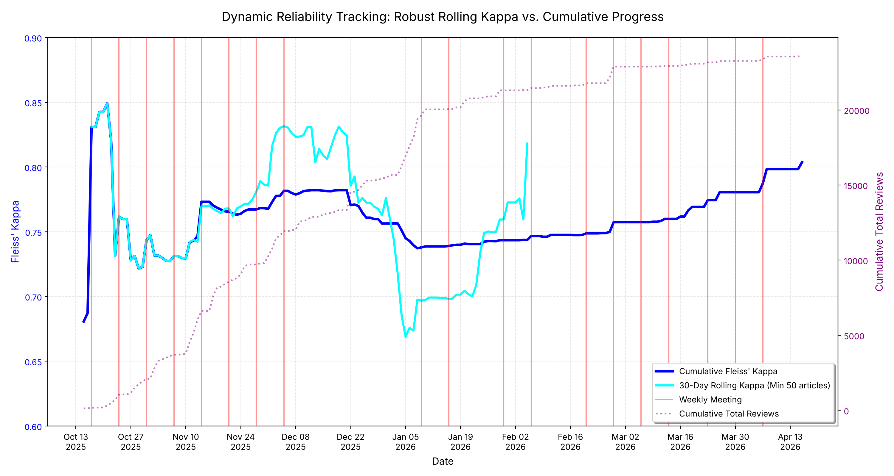

# Monitoring Inter-rater Reliability Over Time During Screening

Code and data for:

> Higgins E, Gainey MA, Aromaih AA, Alroumi A, Alhuzaymi AA, Young S. *The Value of Monitoring Inter-rater Reliability Over Time During Title and Abstract Screening for Scoping Reviews.* Research Synthesis Methods. [year, volume, DOI once published]

This repository shows how to calculate and monitor **rolling** and **cumulative** Fleiss' kappa during title and abstract screening. It is written for review teams without specialist statistical or programming training.

- **Cumulative kappa** measures agreement across every decision made so far.
- **Rolling kappa** measures agreement across only the decisions made in the last 30 days.

Plotting both over time, alongside team meetings, shows how reviewer agreement develops and stabilizes during a review.



---

## Contents

1. [Files](#1-files)
2. [Steps](#2-steps)
3. [The formula](#3-the-formula)
4. [Worked example](#4-worked-example)
5. [Choosing the rolling window](#5-choosing-the-rolling-window)
6. [Reading the plot](#6-reading-the-plot)
7. [Running the code](#7-running-the-code)
8. [Citation](#8-citation)

---

## 1. Files

| File | Description |
| --- | --- |
| `codecalc.py` | Calculates daily cumulative and rolling Fleiss' kappa, draws the plot, and saves the results. |
| `user-answers.csv` | Our anonymized screening decisions, exported from [Sysrev](https://www.sysrev.com/). One row per decision. |
| `dynamic_rolling_kappa.png` | The plot (Figure 1 in the paper). |
| `dynamic_rolling_data.csv` | The daily values behind the plot. |

---

## 2. Steps

1. **Export screening decisions.** One row per decision, with the article ID, reviewer ID, decision (include or exclude), and the date and time it was recorded.
2. **Keep double-screened articles.** Agreement can only be measured on articles screened by at least two reviewers.
3. **Select the decisions for each day.** For cumulative kappa, use every decision recorded up to that day. For rolling kappa, use only decisions recorded in the preceding 30 days; an article counts only if at least two of its decisions fall within that window.
4. **Count the votes** for include and exclude on each article.
5. **Calculate Fleiss' kappa** using the formula in [Section 3](#3-the-formula).
6. **Apply a minimum.** Leave rolling kappa blank on any day whose window holds fewer than 50 double-screened articles.
7. **Plot and annotate** both lines over time with meeting dates, criteria changes, and screening volume.

`codecalc.py` does steps 2 to 7 for you.

---

## 3. The formula

For article $i$ screened by $n_i$ reviewers, of whom $n_{ij}$ chose category $j$ (include or exclude), across $N$ articles:

$$P_i = \frac{\sum_j n_{ij}(n_{ij}-1)}{n_i(n_i-1)} \qquad \bar{P} = \frac{1}{N}\sum_{i=1}^{N} P_i$$

$$p_j = \frac{\sum_i n_{ij}}{\sum_i n_i} \qquad P_e = \sum_j p_j^2$$

$$\kappa = \frac{\bar{P}-P_e}{1-P_e}$$

In plain terms:

- **$P_i$** is the share of reviewer pairs who agreed on article $i$. With two reviewers it is 1 if they agreed and 0 if they did not. With three reviewers voting include, include, exclude, one of the three possible pairs agrees, so $P_i = 1/3$. Because it is calculated per article, the formula works when articles have different numbers of reviewers.
- **$\bar{P}$** is the observed agreement: the average of $P_i$ across articles.
- **$p_j$** is the share of all votes in category $j$.
- **$P_e$** is the agreement expected by chance if reviewers voted at random in those proportions.
- **$\kappa$** is how much better than chance the reviewers did, where 0 means no better than chance and 1 means perfect agreement.

---

## 4. Worked example

Ten articles are each screened by two reviewers:

| | Reviewer 1: include | Reviewer 1: exclude |
| --- | :---: | :---: |
| **Reviewer 2: include** | 2 | 1 |
| **Reviewer 2: exclude** | 1 | 6 |

1. **Observed agreement.** The reviewers agree on 8 articles and disagree on 2, so $\bar{P} = 8/10 = 0.80$.
2. **Share of votes.** Of 20 votes, include receives $2\times2 + 2\times1 = 6$ ($p = 0.30$) and exclude receives 14 ($p = 0.70$).
3. **Chance agreement.** $P_e = 0.30^2 + 0.70^2 = 0.09 + 0.49 = 0.58$.
4. **Kappa.** $\kappa = (0.80 - 0.58)/(1 - 0.58) = 0.22/0.42 \approx 0.52$.

Raw agreement of 80% appears high, but because most articles are excluded, two reviewers would agree 58% of the time by chance alone. Kappa measures only the agreement beyond chance, which is why it is lower.

---

## 5. Choosing the rolling window

A shorter window shows change quickly but fluctuates more, because each window holds fewer articles. A longer window is smoother but slower to show that something has changed. Size the window by the number of double-screened articles it holds, not only by days. In the example above, with chance agreement near 0.58, one additional disagreement among 50 articles moves kappa by about 0.05, so windows much smaller than 50 articles swing widely.

In our project, a 30-day window spanned about four weekly meetings and typically held about 1,075 double-screened articles. Lower-volume reviews can use a longer window, or a window of the most recent 50 to 100 double-screened articles. Report the window length and minimum article count you choose.

---

## 6. Reading the plot

| Line | What it shows |
| --- | --- |
| Dark blue, solid | Cumulative kappa |
| Light blue, solid | 30-day rolling kappa (gaps mean fewer than 50 double-screened articles in the window) |
| Red, vertical | Team meetings |
| Purple, dotted (right axis) | Cumulative number of screening decisions |

- **Rolling below cumulative:** recent agreement is worse than the project average. Look for new reviewers, a recent criteria change, or a gap in meetings.
- **Rolling at or above cumulative, and holding:** recent agreement is improving, and the learning phase may be ending.
- **Both lines flat and converged:** agreement is stable. This shows reviewers are applying the criteria consistently, not necessarily correctly; pair it with accuracy checks such as expert review of a random sample of agreed decisions.
- **A sharp swing in a low-volume window:** probably noise. Check how many articles the window held before acting.

Kappa is often described using benchmark bands, such as Landis and Koch (1977) or McHugh (2012). These are a guide rather than a pass mark.

---

## 7. Running the code

### Install

1. Install Python 3 from [python.org/downloads](https://www.python.org/downloads/). On Windows, tick **"Add Python to PATH"** during installation.
2. Open a terminal (Terminal on Mac, Command Prompt on Windows) and install the three libraries the script uses:

   ```
   pip install pandas numpy matplotlib
   ```

   On some Macs, use `python3` and `pip3` in place of `python` and `pip`.

3. Download this repository: click the green **Code** button, then **Download ZIP**, and unzip it.

### Run on our data

In the terminal, move into the downloaded folder and run the script:

```
cd path/to/kappa_calculations
python codecalc.py
```

It saves `dynamic_rolling_kappa.png` and `dynamic_rolling_data.csv` in the same folder.

### Run on your own review

1. **Prepare a CSV** with these four columns, named exactly as shown:

   | Column | Contents | Example |
   | --- | --- | --- |
   | `article_id` | ID of the article | `art_103685753` |
   | `user_id` | ID of the reviewer | `user_183508` |
   | `answer` | `TRUE` for include, `FALSE` for exclude | `TRUE` |
   | `created_at` | Date and time of the decision, with a time zone | `2025-10-30 00:44:26+00:00` |

   Rows with any other `answer` value (such as "Include" or "Maybe") are ignored, so recode them first. Your screening tool must export each reviewer's individual decision with its timestamp, not just the final decision per article.

2. **Edit `codecalc.py`** in any text editor:

   | Setting | Line | Default | What to change |
   | --- | --- | --- | --- |
   | Input file | 7 | `'user-answers.csv'` | Your CSV's file name |
   | Meeting dates | 16–24 | Our meetings | Your meeting dates, as `'YYYY-MM-DD'` |
   | Minimum articles per window | 70 | `50` | See [Section 5](#5-choosing-the-rolling-window) |
   | Window length | 74 | `days=30` | See [Section 5](#5-choosing-the-rolling-window); also update the legend label on line 100 |
   | Y-axis range | 106 | `0.6` to `0.9` | Widen it (e.g. `-0.2, 1.0`) if your kappa falls outside this range, or values will be hidden |

3. **Run** `python codecalc.py`.

### Troubleshooting

- **`ModuleNotFoundError`:** run `pip install pandas numpy matplotlib` again.
- **`FileNotFoundError`:** the CSV isn't in the same folder as the script, or its name doesn't match line 7.
- **`KeyError`:** a column name doesn't exactly match the table above.
- **An error mentioning time zones or "Invalid comparison":** your timestamps have no time zone. Add this line directly after line 8:

  ```python
  df['created_at'] = df['created_at'].dt.tz_localize('UTC')
  ```

- **The rolling line is mostly missing:** your windows hold fewer than 50 double-screened articles. Lengthen the window (line 74).

---

## 8. Citation

If you use this code, please cite the paper above and this repository.

The Python script was written with assistance from Claude Code (Claude Sonnet 4.6).

**References**

- Fleiss JL. Measuring nominal scale agreement among many raters. *Psychological Bulletin*. 1971;76(5):378–382.
- Landis JR, Koch GG. The measurement of observer agreement for categorical data. *Biometrics*. 1977;33(1):159–174.
- McHugh ML. Interrater reliability: the kappa statistic. *Biochemia Medica*. 2012;22(3):276–282.
